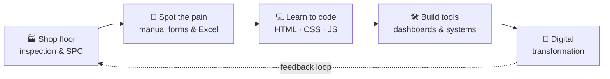

<!-- Generated by GitHub Profile Agent Console. Edit profile.config.json, then run npm run generate. -->

<!-- ═══════════════════════════════════ HEADER ═══════════════════════════════════ -->

<p align="center">
  
</p>

<!-- ═══════════════════════════════════ HERO BANNER ═══════════════════════════════════ -->

<p align="center">
  <picture>
    <source media="(max-width: 760px) and (prefers-color-scheme: dark)" srcset="./assets/hero/agent-console-b1073d36-mobile-dark.svg">
    <source media="(max-width: 760px)" srcset="./assets/hero/agent-console-b1073d36-mobile-light.svg">
    <source media="(prefers-color-scheme: dark)" srcset="./assets/hero/agent-console-b1073d36-dark.svg">
    <source media="(prefers-color-scheme: light)" srcset="./assets/hero/agent-console-b1073d36-light.svg">
    
  </picture>
</p>

<!-- ═══════════════════════════════════ TYPING SVG ═══════════════════════════════════ -->

<p align="center">
  <a href="https://github.com/Prasadboy-ux">
    
  </a>
</p>

<!-- ═══════════════════════════════════ SOCIAL BADGES ═══════════════════════════════════ -->

<p align="center">
  <a href="https://github.com/Prasadboy-ux"></a>
  <a href="https://www.linkedin.com/in/prakash-prasad-550a1a1a8/"></a>
  <a href="https://wa.me/62876388215"></a>
</p>

<p align="center">
  
  
  
  
</p>

<p align="center">
  <a href="#-about-me">About</a> &nbsp;·&nbsp;
  <a href="#-my-journey">Journey</a> &nbsp;·&nbsp;
  <a href="#-tech-stack--quality-toolkit">Toolkit</a> &nbsp;·&nbsp;
  <a href="#-featured-projects">Projects</a> &nbsp;·&nbsp;
  <a href="#-github-analytics">Analytics</a> &nbsp;·&nbsp;
  <a href="#-lets-connect">Connect</a>
</p>


<!-- ═══════════════════════════════════ ABOUT ME ═══════════════════════════════════ -->

## 👋 About Me

<table>
<tr>
<td width="58%" valign="top">

I'm a **Quality engineer who codes**. By day I inspect, measure, and fix problems on the production floor at **PT HLN Batam**. After hours I turn the paper forms and spreadsheets I used to fill in by hand into **web tools and dashboards**.

- 🔬 Daily work: IQC inspection, SPC, RCA, 8D, FMEA, CAPA
- 💻 Learning: web development & digital transformation for manufacturing
- 🎯 Goal: make quality data **faster to capture, easier to see, harder to ignore**

> *"Quality is not an act, it is a habit."* — Aristotle

</td>
<td width="42%" valign="top">

```yaml
Name:     Prakash Prasad
Role:     Assistant QA/QC Engineer
Company:  PT HLN Batam
Location: Batam, Indonesia
Focus:    Quality Assurance
          Process Improvement
          Statistical Analysis
Tools:    SmartScope · SPC · 8D
          FMEA · CAPA · RCA
Code:     HTML · CSS · JavaScript
Editors:  VS Code · Git
```

</td>
</tr>
</table>

<p align="center">
  
  
  
  
</p>

---

<!-- ═══════════════════════════════════ JOURNEY ═══════════════════════════════════ -->

## 🧭 My Journey



<p align="center"><sub>Plan → Do → Check → Act, applied to my own career 🔁</sub></p>

---

<!-- ═══════════════════════════════════ CURRENT FOCUS ═══════════════════════════════════ -->

## 🎯 Current Focus

<table>
<tr>
<td width="50%" valign="top">

### 🏗️ Quality Systems
Implementing and maintaining ISO 9001, 14001, 45001 and 19011 compliant frameworks.

### 📈 Process Improvement
SPC, root cause analysis, 8D, FMEA and CAPA to cut defects and stabilise production quality.

</td>
<td width="50%" valign="top">

### 🔬 Inspections & QA
IQC inspections with SmartScope and other tools so materials and products meet specification.

### 🧩 Digital Quality Tools
Dashboards and web apps that streamline QA workflows, track defects, and visualise quality metrics.

</td>
</tr>
</table>

---

<!-- ═══════════════════════════════════ TECH STACK ═══════════════════════════════════ -->

## 🧰 Tech Stack & Quality Toolkit

<table>
<tr>
<td width="50%" valign="top" align="center">

**💻 Dev Toolkit**


<sub>**Next up:** Node.js · Express · PostgreSQL · REST APIs</sub>

<p>
  
  
  
</p>

</td>
<td width="50%" valign="top" align="center">

**🔬 Quality Toolkit**

<br/>
<br/>
<br/>
<br/>
<br/>


</td>
</tr>
</table>

---

<!-- ═══════════════════════════════════ FEATURED WORK ═══════════════════════════════════ -->

## 🚀 Featured Projects

<table>
<tr>
<td width="50%" valign="top">

### 🔎 IQC Inspection
A digital system for managing incoming quality inspections, tracking defects, and generating compliance reports.

<a href="https://github.com/Prasadboy-ux/IQC-Inspection-System"></a>

</td>
<td width="50%" valign="top">

### 📊 QA Dashboard
An interactive dashboard for monitoring quality KPIs, defect trends, and process capability metrics in real time.

<a href="https://github.com/Prasadboy-ux/QA-Engineering-Dashboard"></a>

</td>
</tr>
<tr>
<td width="50%" valign="top">

### 🧪 Rubber Mfg SPC
A specialised SPC system for rubber manufacturing to monitor variability and keep product consistent.

<a href="https://github.com/Prasadboy-ux/Rubber-Manufacturing-SPC-System"></a>

</td>
<td width="50%" valign="top">

### 🎓 NextGenAcademy
A modern learning platform built to deliver quality education content with an intuitive user experience.

<a href="https://github.com/Prasadboy-ux/NextGenAcademy"></a>

</td>
</tr>
</table>

---

<!-- ═══════════════════════════════════ ANALYTICS ═══════════════════════════════════ -->

## 📊 GitHub Analytics

<p align="center">
  
  
</p>

<p align="center">
  
</p>

### 📋 Profile Overview

| Metric | Value |
| --- | --- |
| 📦 Public Repositories | 5 |
| ⭐ Total Stars | 1 |
| 🍴 Total Forks | 0 |
| 📝 Total Commits | 19 |
| 👥 Followers | 1 |
| 👤 Following | 1 |

<details>
<summary><b>📦 All Public Repositories</b> &nbsp;(click to expand)</summary>
<br/>

| Repository | Language | ⭐ Stars | 🍴 Forks | Updated |
| --- | --- | ---: | ---: | --- |
| [**image-slider**](https://github.com/Prasadboy-ux/image-slider) | JavaScript | 0 | 0 | Sep 12, 2026 |
| [**task-owner-dashboard**](https://github.com/Prasadboy-ux/task-owner-dashboard) | JavaScript | 0 | 0 | Sep 12, 2026 |
| [**Blur-Theme**](https://github.com/Prasadboy-ux/Blur-Theme) | Python | 1 | 0 | Sep 10, 2026 |
| [**Prasadboy-ux**](https://github.com/Prasadboy-ux/Prasadboy-ux) | JavaScript | 0 | 0 | Sep 9, 2026 |
| [**rollmaster-cli**](https://github.com/Prasadboy-ux/rollmaster-cli) | Python | 0 | 0 | Aug 30, 2026 |

</details>

<details>
<summary><b>💻 Language Breakdown</b> &nbsp;(by repository &amp; by commits)</summary>
<br/>

**Top language by repository** — counts how many repositories use each primary language.

- `JavaScript   ██████████████ 60%`
- `Python       █████████      40%`

**Top language by commit activity** — sums commit counts per repository, grouped by the repository's primary language (largest language bytes on GitHub).

- `JavaScript   ██████████████ 73.68%`
- `Python       █████          26.32%`

</details>

<details>
<summary><b>⭐ Most Starred Projects</b></summary>
<br/>

`1.` [**Blur-Theme**](https://github.com/Prasadboy-ux/Blur-Theme) — ⭐ 1

</details>

<p align="center">


</p>

<!-- AUTO:ANALYTICS:START -->

<!-- AUTO:ANALYTICS:END -->

---

<!-- ═══════════════════════════════════ SNAKE ═══════════════════════════════════ -->

## 🐍 Contribution Snake

<p align="center">
  <picture>
    <source media="(prefers-color-scheme: dark)" srcset="https://raw.githubusercontent.com/Prasadboy-ux/Prasadboy-ux/output/github-contribution-grid-snake-dark.svg" />
    <source media="(prefers-color-scheme: light)" srcset="https://raw.githubusercontent.com/Prasadboy-ux/Prasadboy-ux/output/github-contribution-grid-snake.svg" />
    
  </picture>
</p>

---

<!-- ═══════════════════════════════════ RESEARCH ═══════════════════════════════════ -->

## 🔬 Research Direction

<blockquote>

I am focused on building dependable quality systems that integrate statistical process control, ISO standards compliance, and structured problem-solving methods. My goal is to ensure every product and process meets defined quality thresholds through systematic inspection, data-driven decisions, and continuous improvement frameworks such as CAPA and FMEA.

</blockquote>

---

<!-- ═══════════════════════════════════ ACTIVITY ═══════════════════════════════════ -->

## ⚡ Recent Activity

<!-- AUTO:ACTIVITY:START -->
_No recent public activity was found._
<!-- AUTO:ACTIVITY:END -->

---

<!-- ═══════════════════════════════════ CONNECT ═══════════════════════════════════ -->

## 🤝 Let's Connect

<p align="center">
  Open to talking about <b>quality engineering</b>, <b>digital transformation in manufacturing</b>, and <b>learning to code</b>.
</p>

<p align="center">
  <a href="https://www.linkedin.com/in/prakash-prasad-550a1a1a8/"></a>
  <a href="https://wa.me/62876388215"></a>
  <a href="https://github.com/Prasadboy-ux"></a>
</p>

<!-- ═══════════════════════════════════ FOOTER ═══════════════════════════════════ -->

<p align="center">
  
</p>

<p align="center">
  <b>Building quality systems that deliver reliable results.</b>
</p>

<p align="center">
  
</p>
